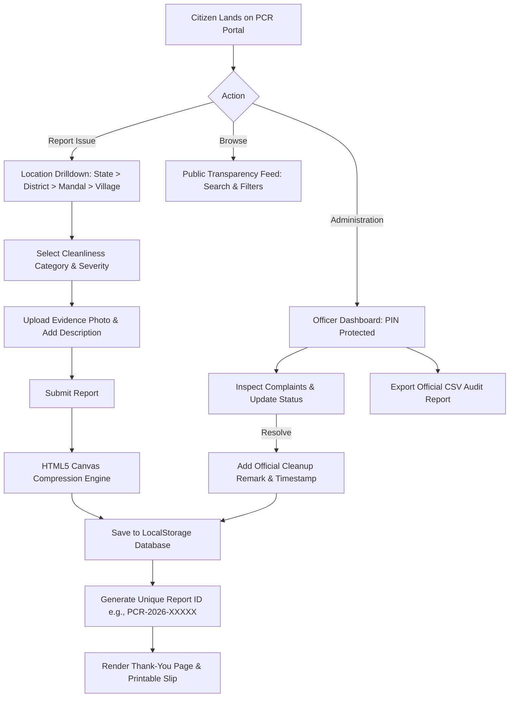

# PBL Mini Project Report Documentation
## Project Title: Public Cleanliness Reporter (PCR)
**Domain:** Web Development & Civic Technology (Smart Governance / Swachh Bharat Initiative)  
**Target Platform:** Cross-Platform Web (Mobile & Desktop Responsive)  
**Technology Stack:** HTML5, CSS3 (Custom Responsive Design System), JavaScript (ES6+), Web Storage API (`localStorage`), HTML5 Canvas Image Optimization  

---

### 1. Abstract
Rapid urbanization and expanding rural populations have led to significant civic sanitation challenges, including irregular garbage collection, overflowing waste bins, open sewage overflow, and roadside waste burning. In traditional administrative setups, citizens face difficulties identifying the appropriate municipal authority or gram panchayat ward officer to report local hygiene hazards. 

The **Public Cleanliness Reporter** is a decentralized, citizen-centric web application designed to bridge this communication gap. It provides an intuitive, step-by-step hierarchical location navigation system (State &rarr; District &rarr; Mandal &rarr; Village/Ward) that pinpoints the exact jurisdiction of the complaint. Citizens can categorize issues, attach photographic evidence, specify urgency, and receive a unique tracking complaint ID. Concurrently, a public transparency feed empowers communities to monitor the status of civic grievances, while a dedicated municipal administration console enables authorities to update task statuses (Pending, In Progress, Resolved), attach official remarks, and export reports for administrative audits.

---

### 2. Problem Statement
In existing municipal complaint mechanisms:
1. **Ambiguous Jurisdictions:** Citizens often do not know whether a specific street falls under a Municipal Corporation, a Municipality, or a Gram Panchayat, resulting in misdirected complaints.
2. **Lack of Transparency:** Once a citizen reports an issue, there is rarely a public ledger or tracking mechanism to confirm if action was taken.
3. **Complex Formalities:** Many government complaint portals require complex multi-step Aadhaar or OTP logins, discouraging quick reporting of urgent hazards like open drains or burning plastic.
4. **Heavy Backend Dependencies:** Many civic apps suffer downtime due to server outages or database connectivity failures during critical field inspections.

---

### 3. Proposed System & Objectives
The **Public Cleanliness Reporter** resolves these limitations through a lightweight, client-side, zero-latency architecture:
- **Hierarchical Location Wizard:** Guides users through State &rarr; District &rarr; Mandal &rarr; Village/Ward selection with interactive search filters and dynamic breadcrumbs.
- **Categorized Issue Reporting:** Pre-configured with the 7 most frequent civic sanitation challenges, including custom options.
- **Client-Side Photo Compression:** Compresses user-uploaded photos via HTML5 Canvas before persisting to `localStorage`, preventing browser storage quota overflow.
- **Transparent Public Tracking:** A searchable community feed where citizens can filter complaints by village, problem category, and status.
- **Action-Oriented Officer Portal:** Equips sanitation officers to update complaint statuses, record resolution timestamps, and add official municipal notes.
- **Export Functionality:** Enables export of all registered complaints into CSV format for municipal record-keeping.

---

### 4. System Architecture & Workflow

---

### 5. Technology Stack & Justification

| Technology | Role | Justification |
| :--- | :--- | :--- |
| **HTML5** | Semantic UI Structure | Accessible semantic tags (`<header>`, `<main>`, `<section>`, `<nav>`, `<form>`) ensuring high performance, SEO friendliness, and zero external build overhead. |
| **CSS3** | Modern Eco-Design System | Custom CSS variables, responsive grid/flexbox layouts, glassmorphism overlays, and micro-animations for an inspiring, premium citizen experience. |
| **JavaScript (ES6+)** | Dynamic Logic & Routing | Modular functions managing client-side view switching, hierarchical data filtering, breadcrumbs, and modal state without heavy frameworks. |
| **Web Storage API (`localStorage`)** | Data Persistence Layer | Persists complaints, resolution timestamps, and officer remarks permanently across browser sessions without needing a live backend server. |
| **HTML5 Canvas API** | In-Browser Image Compression | Scales down camera captures to a maximum dimension of 800px and encodes to JPEG (0.72 quality), shrinking 5MB images to ~60KB. |

---

### 6. Modules Description

#### Module 1: Clean-City Landing & Impact Hero
- Displays a full-screen, high-resolution eco-city landscape reflecting the vision of clean civic infrastructure.
- Features primary calls to action ("Start Reporting Now", "Browse Public Reports", "Officer Portal").
- Presents a 4-step civic workflow guide ("Pin Location", "Select Problem", "Add Photo", "Track Resolution").

#### Module 2: 5-Level Hierarchical Location Drilldown
- Implemented as an interactive single-page wizard.
- Steps: **State** &rarr; **District** &rarr; **Mandal/Tehsil** &rarr; **Village/Ward**.
- Features real-time search inputs at each step, dynamic breadcrumb navigation, and back-step capabilities allowing users to modify selections easily.

#### Module 3: Problem Identification & Evidence Form
- Categorized hazard selector:
  1. Garbage not collected
  2. Overflowing dustbin
  3. Open drain / sewage blockage
  4. Stagnant water / mosquitoes
  5. Public toilet dirty
  6. Burning of waste
  7. Other (reveals dynamic custom input)
- Priority selector (Normal, Urgent, Critical Hazard).
- One-click Mock GPS locator stamping geographic coordinates.
- Drag-and-drop file uploader with live thumbnail preview and deletion.

#### Module 4: Confirmation & Receipt Generation
- Displays a unique alphanumeric complaint code (e.g., `PCR-2026-89412`).
- Provides a "Copy ID" clipboard trigger and a "Print / Save PDF Receipt" trigger for citizen documentation.

#### Module 5: Public Transparency Feed
- Public searchable repository of all submitted complaints.
- Multi-dimensional filtering: by Status (Pending, In Progress, Resolved), Problem Type, State, and District.
- Interactive modal showing full evidence photos, reporter details, and official municipal action remarks.

#### Module 6: Municipal Administration Dashboard
- Protected by PIN authentication (`admin123`) with one-click demo access for academic presentation.
- Key Performance Indicator (KPI) metrics cards: Total Complaints, Pending Verification, In-Progress Operations, Resolved Count, and Cleanliness Resolution Rate (%).
- Actionable management table with direct triggers: **"Resolve"** (with prompt for resolution notes), **"In Progress"**, **"Inspect"**, and **"Delete"**.
- Built-in CSV exporter generating timestamped complaint spreadsheets.

---

### 7. Software Testing & Test Cases

| Test Case ID | Test Scenario | Input Data | Expected Result | Status |
| :--- | :--- | :--- | :--- | :--- |
| **TC-01** | Location drill-down navigation | Select Telangana &rarr; Hyderabad &rarr; Serilingampally &rarr; Gachibowli | Breadcrumb updates smoothly; form renders with verified jurisdiction | Pass |
| **TC-02** | Form validation on empty submit | Leave name & phone blank, click Submit | Form halts submission; triggers prompt for required inputs | Pass |
| **TC-03** | Phone number format validation | Input `12345` (less than 10 digits) | Browser pattern validation triggers warning for valid 10-digit number | Pass |
| **TC-04** | "Other" option dynamic input | Select radio button "Other" | Custom text box appears with smooth CSS animation | Pass |
| **TC-05** | Image compression verification | Upload 4MB camera photo | Photo compressed into Base64 (~65KB) without exceeding `localStorage` limits | Pass |
| **TC-06** | Public feed filter by status | Click "Resolved" filter tab | Only complaints marked "Resolved" are rendered | Pass |
| **TC-07** | Admin status update | Click "Resolve" and enter resolution remark | Report status changes to Resolved; official remark saved and shown on public card | Pass |
| **TC-08** | CSV Data Export | Click "Export CSV" in Admin portal | Browser triggers download of `.csv` file containing structured complaint records | Pass |

---

### 8. Future Enhancements
1. **GIS Heatmaps:** Integration of OpenStreetMap / Leaflet.js to display real-time geographic heatmaps of cleanliness hotspots across mandals.
2. **AI Garbage Classifier:** Client-side TensorFlow.js model to automatically analyze uploaded photos and predict waste category and volume.
3. **Automated WhatsApp / SMS Bot:** Integration with Twilio API to notify citizens via WhatsApp when their complaint is marked as "Resolved" by the municipal crew.
4. **PWA (Progressive Web App):** Service Worker caching to allow offline complaint queuing when citizens are in low-connectivity rural areas.

---

### 9. Top 10 Viva Questions & Model Answers for Students

**Q1: Why did you choose Vanilla JavaScript instead of a framework like React or Angular for this project?**  
*Answer:* Vanilla JavaScript was deliberately chosen to minimize dependencies, eliminate compilation/bundling steps, and demonstrate mastery of core DOM manipulation, event delegation, and asynchronous browser APIs. It allows the project to be portable and run instantaneously on any machine by opening `index.html`.

**Q2: How does the application handle image storage without a dedicated database server?**  
*Answer:* We utilized the HTML5 Canvas API to compress and resize the uploaded images to a maximum width/height of 800px with a 0.72 quality factor. This converts high-resolution images into lightweight Base64 strings (~50-80 KB), allowing them to be stored reliably within the browser's 5MB `localStorage` limit without throwing `QuotaExceededError`.

**Q3: How does the location drilldown work under the hood?**  
*Answer:* The location structure is maintained in `js/data.js` as a nested JavaScript object hierarchy: `State` &rarr; `districts` &rarr; `mandals` &rarr; `villages`. When a user clicks a card, an event handler captures the key, updates the application state, updates the breadcrumb bar, and dynamically populates the child entities in the grid.

**Q4: How is citizen privacy preserved in the public feed?**  
*Answer:* On public cards and modals, citizens' contact phone numbers can be masked (e.g., `9876****10`) so that personal contact details are not exposed to the public while remaining visible to verified municipal admins.

**Q5: What happens if a user refreshes the browser? Is their report lost?**  
*Answer:* No. All reports are immediately committed to `localStorage`. When the app loads, `initApp()` checks for existing stored reports and loads them. If no records exist, it seeds the initial demo records.

**Q6: How does the CSV export feature operate without a backend?**  
*Answer:* We create a CSV-formatted string from the JSON objects in `localStorage`, prepend the UTF-8 Byte Order Mark (`\uFEFF`), instantiate a browser `Blob`, create a dynamic object URL using `URL.createObjectURL()`, and trigger an automated click on an anchor element to initiate the download.

**Q7: Can a user jump back to a previous location step without starting over?**  
*Answer:* Yes. The breadcrumb component (`State > District > Mandal > Village`) is interactive. Clicking on "District" resets Mandal and Village while preserving the selected State and District.

**Q8: What is the significance of the Report ID format?**  
*Answer:* The ID follows the pattern `PCR-2026-[timestamp][random]`. This guarantees uniqueness, provides a chronological timestamp reference, and mimics real-world municipal grievance numbering systems.

**Q9: What makes this design modern and citizen-friendly?**  
*Answer:* The interface uses custom typography (`Outfit` and `Plus Jakarta Sans`), an eco-friendly emerald green color palette (`#059669`, `#10b981`), glassmorphism cards, glowing status pulse badges, and instant visual feedback via animated toast notifications.

**Q10: How can this project be scaled in a real-world municipal corporation?**  
*Answer:* The client-side structure can be connected via REST or GraphQL APIs to a backend database (e.g., PostgreSQL / Node.js) and integrated with IoT-enabled smart waste bins and municipal GPS-tracked waste collection trucks.
